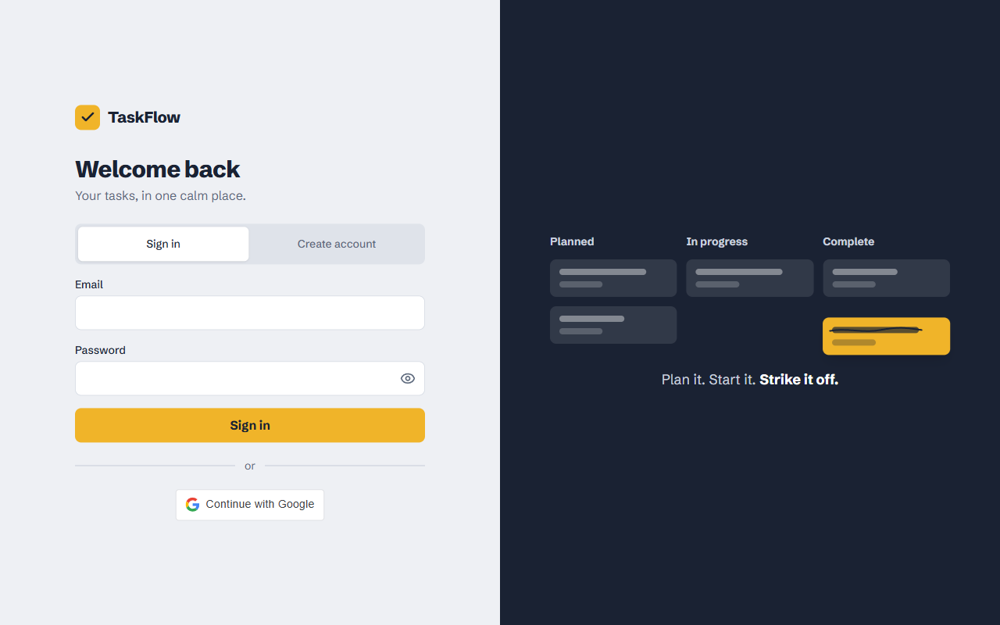
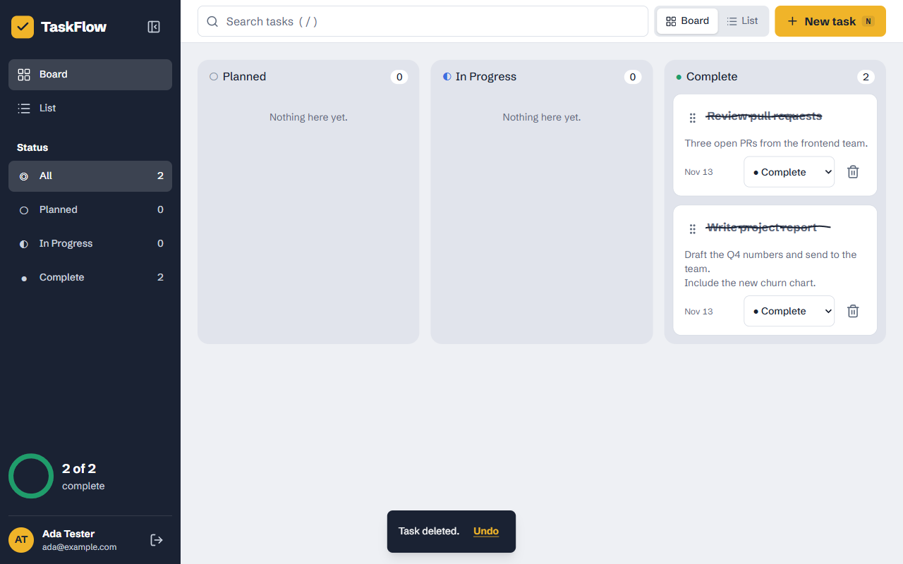
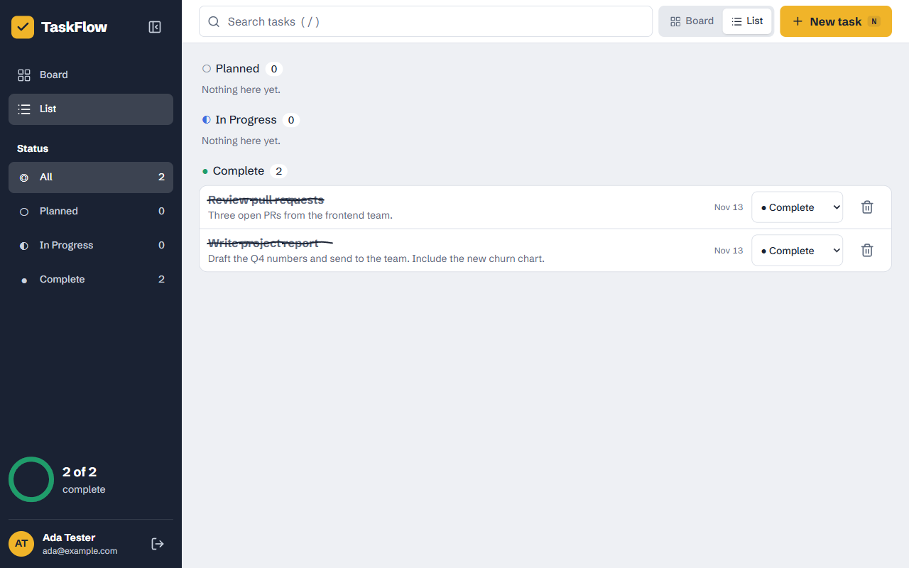
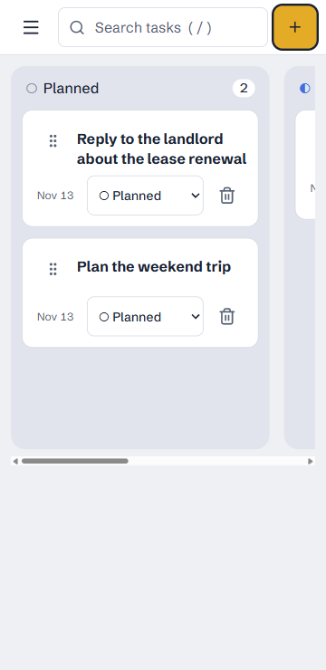

# TaskFlow

A single-page personal task list. Create an account with email and password, or continue with Google. Add tasks, move them between **Planned / In Progress / Complete** on a board (drag and drop) or in a list, filter and search, and delete them (with Undo). Each person sees only their own tasks.

| Sign in | Board |
| --- | --- |
|  |  |

| List | Phone (360 px) |
| --- | --- |
|  |  |

**Live app:** https://taskflow-zb8j.onrender.com (free hosting: the first load can take up to a minute)

## Architecture

One repository, one deployed service. The React frontend is built into static files (`frontend/dist`). In production the Flask backend serves those files **and** the JSON API under `/api` from the same origin, so there is no CORS and no second server. In development the Vite dev server proxies `/api` to Flask, which behaves the same way. There are two ways to sign in, and both end the same way: the backend stores only the user id in a signed, HttpOnly session cookie. With Google, the browser gets a signed ID token and the backend verifies it with `google-auth`. With email and password, the backend checks a salted Werkzeug hash. Data lives in PostgreSQL (Neon) in production and SQLite locally.

## Stack

| Piece | Why |
| --- | --- |
| React + Vite (JavaScript) | Simple component model and a fast dev/build tool |
| Tailwind CSS | Styling without writing a CSS framework by hand |
| @dnd-kit/core | Accessible drag and drop (mouse, touch and keyboard) for the board |
| lucide-react | Consistent icons |
| @react-oauth/google | Google sign-in button |
| Flask (app factory) | Small, readable web framework |
| Flask-SQLAlchemy | All DB access through an ORM, so no string-built SQL |
| google-auth | Google's own library for verifying ID tokens |
| gunicorn | Production WSGI server |
| PostgreSQL (Neon) / SQLite | Free hosted DB in production, zero-setup locally |
| pytest / Vitest | Backend API tests / frontend helper tests |
| Render | Free hosting for one web service |

## Local setup

You need Python 3.11+ and Node 20+. For the optional "Continue with Google" button you also need a Google OAuth **Web** client ID:
Google Cloud Console → APIs & Services → Credentials → Create credentials → OAuth client ID → Web application. Under **Authorized JavaScript origins** add `http://localhost:5173`. (If you use a Firebase project, it is the same Google Cloud project.) Copy the Client ID.

### Backend

```bash
cd backend
python -m venv venv
# Windows PowerShell:  .\venv\Scripts\Activate.ps1
# macOS / Linux / Git Bash:  source venv/bin/activate   (Git Bash on Windows: source venv/Scripts/activate)
pip install -r requirements-dev.txt
cp .env.example .env        # optional: set GOOGLE_CLIENT_ID in .env; leave the rest empty locally
flask --app wsgi run --port 5000
```

With no `DATABASE_URL`, a SQLite file (`backend/instance/taskflow.db`) is created automatically. (If `DATABASE_URL` points at a real Neon database, running locally changes that database too.)

### Frontend (second terminal)

```bash
cd frontend
npm install
cp .env.example .env        # optional: set VITE_GOOGLE_CLIENT_ID (same value as above)
npm run dev
```

Open <http://localhost:5173> and create an account, or continue with Google. Email and password works without any Google setup.

### Tests and build

```bash
cd backend && pytest            # API tests (no network; Google verification is faked)
cd frontend && npm test         # Vitest: validation, status, search and format helpers
cd frontend && npm run lint     # ESLint
cd frontend && npm run build    # production build into frontend/dist
```

To try the production setup locally, run `npm run build` in `frontend`, then `flask --app wsgi run --port 5000` in `backend` and open <http://localhost:5000>.

## Deploy (Render, free)

1. Push this repo to GitHub.
2. Create a free PostgreSQL database on [Neon](https://neon.tech) and copy its connection string.
3. In Render: **New → Blueprint**, pick the repo. Render reads `render.yaml`.
4. When asked, fill in `GOOGLE_CLIENT_ID`, `VITE_GOOGLE_CLIENT_ID` (both are your Google Client ID, only needed for the Google button) and `DATABASE_URL`. For `DATABASE_URL` paste only the Neon string that starts with `postgresql://`, with no quotes or extra words. `SECRET_KEY` is generated for you and `FLASK_ENV` is set to `production` by `render.yaml`.
5. After the first deploy, copy your `https://….onrender.com` URL into Google Cloud Console → your OAuth client → **Authorized JavaScript origins**. Update the live URL at the top of this file.

Render's Python runtime includes Node, so the build command installs Python packages and runs `npm ci && npm run build` in one go. The free service sleeps when idle; the first request can take up to a minute.

## API

All requests and responses are JSON. `POST`, `PATCH` and `DELETE` must send `Content-Type: application/json`. Errors look like `{"error": {"code": "...", "message": "..."}}`.

| Method | Path | Description | Errors |
| --- | --- | --- | --- |
| POST | `/api/auth/register` | Body `{name, email, password}`. Creates the account and signs in (201) | 400, 409 |
| POST | `/api/auth/login` | Body `{email, password}`. Signs in. Unknown email, wrong password and Google-only accounts give the same 401 | 400, 401, 429 |
| POST | `/api/auth/google` | Body `{credential}`. Verifies the Google token, signs in, returns the user | 400, 401 |
| GET | `/api/auth/me` | Current user, including `auth_methods` (never the password hash) | 401 |
| POST | `/api/auth/logout` | Ends the session | |
| GET | `/api/tasks` | Your tasks, newest first | 401 |
| POST | `/api/tasks` | Body `{title, description?}`. Status is always `planned` | 400, 401 |
| PATCH | `/api/tasks/<id>` | Body `{status}` only | 400, 401, 404 |
| DELETE | `/api/tasks/<id>` | Deletes a task | 401, 404 |
| GET | `/api/health` | `{"status": "ok"}`, no session needed | |

Status codes: 400 validation, 401 not signed in or bad credentials, 404 not found (also used for other people's tasks), 409 email already registered, 415 wrong content type, 429 too many failed logins, 500 unexpected.

## Security summary

- The Google ID token is verified on the server (signature, expiry, issuer, audience = our client ID, `email_verified`). Users are identified by the token's `sub`.
- Passwords: 8 to 128 characters, never trimmed, stored only as a salted Werkzeug hash. Login answers identically for unknown email, wrong password and Google-only accounts, and still checks a dummy hash so timing does not reveal which emails exist. After 5 failed logins for one email in 15 minutes, further attempts get 429.
- Google linking: if someone signs in with Google using an email that already has a password account, the accounts are linked and the password is removed. Nobody verified the email when the password was set, so otherwise anyone could have registered someone else's email first.
- Session: signed cookie with only the user id; HttpOnly, SameSite=Lax, Secure in production, 7 days. The app refuses to start in production without `SECRET_KEY`.
- Every task query is filtered by the session's user id; someone else's task returns 404.
- CSRF: JSON-only content type + SameSite=Lax + no CORS (explained in `backend/app/__init__.py`).
- The server validates all input; all DB access goes through SQLAlchemy.

## Upgrading an existing database (email + password sign-in)

`db.create_all()` never alters tables that already exist, so a database created before password accounts needs three changes. The app runs the equivalent steps itself at startup on PostgreSQL (safe to repeat). To run them by hand, for example in Neon's SQL Editor:

```sql
ALTER TABLE users ADD COLUMN IF NOT EXISTS password_hash VARCHAR(255);
ALTER TABLE users ALTER COLUMN google_sub DROP NOT NULL;
UPDATE users SET email = lower(trim(email)) WHERE email IS NOT NULL;
-- first check this returns no rows (duplicate emails would block the index):
SELECT lower(email) FROM users WHERE email IS NOT NULL GROUP BY 1 HAVING count(*) > 1;
CREATE UNIQUE INDEX IF NOT EXISTS ix_users_email ON users (email);
```

A local SQLite file from before this change is not upgraded: the app stops with a message, so delete `backend/instance/taskflow.db` and restart.

## Known limitations

- No database migrations: tables are created with `db.create_all()` at startup, so changing a column later needs a manual change.
- Titles and descriptions cannot be edited after creation.
- Login lockout is in memory: each gunicorn worker counts separately and a restart clears it (a shared store such as Redis or the database is the production fix). It is also per email, so someone can lock a victim out of password sign-in for 15 minutes by guessing wrongly; Google sign-in still works.
- No email verification and no password reset: a forgotten password cannot be recovered.
- Delete is final 5 seconds after pressing it. Closing the tab inside that window keeps the task.
- No pagination (meant for up to a few hundred tasks per user), no account deletion, no data export.
- Free hosting sleeps when idle, so the first load is slow.

## Project structure

```
render.yaml            Render deploy blueprint
backend/
  wsgi.py              gunicorn entry point
  requirements*.txt    Python dependencies
  .env.example         backend settings template
  app/
    __init__.py        create_app: config, security settings, serving the frontend
    models.py          User and Task tables, status list
    auth.py            register, login (rate limited), Google token check, session
    schema.py          startup upgrade of an older users table
    tasks.py           /api/tasks routes and validation
    errors.py          one JSON error format
  tests/               pytest: tasks, Google auth, password auth, production settings
frontend/
  .env.example         frontend settings template
  index.html           page shell and the font
  vite.config.js       Vite + Tailwind + /api proxy
  eslint.config.js     lint rules
  public/favicon.svg   browser tab icon
  src/
    main.jsx           entry, Google provider
    index.css          colours, font, animations (Tailwind theme)
    App.jsx            session check, auth screen vs app
    api.js             fetch wrapper and error messages
    status.js          statuses (single source of truth), filter, count, search, sort
    validation.js      title, description, name, email, password checks
    format.js          initials and date helpers
    *.test.js          Vitest tests
    hooks/             useTasks (data + optimistic moves + undo delete), useToasts, useIsMobile
    components/        AuthScreen, AppShell, Sidebar, TopBar, Board, ListView, TaskCard,
                       QuickAddDialog, Toasts and small pieces (Logo, Avatar, ProgressRing, ...)
docs/                  USER_GUIDE, ASSUMPTIONS, AI_USAGE, BUILD_LOG, screenshots/
```
